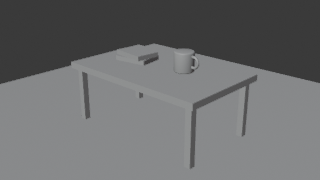
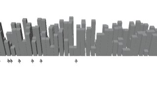

# blender-axi

An agent-ergonomic CLI for Blender that follows the [AXI principles](https://axi.md): compact TOON
output, content-first home view, structured errors with exit codes, next-step hints and short
per-command help. It runs Blender headless (`blender --background`) by default; an optional live mode
talks to a running Blender through the official MCP add-on's socket.

Licensed GPL-3.0-or-later (see `LICENSE`).

## Why: fewer tokens for AI agents working in Blender

blender-axi exists to cut the context an AI agent spends on Blender. It does this in three ways.

1. **No per-session tool schemas.** An MCP client loads every tool definition into context at the
   start of every session. blender-axi is a CLI. Its agent skill (`skills/blender-axi/SKILL.md`)
   loads only when a Blender task comes up, and `blender-axi --help` covers the rest.
2. **Compact output.** TOON tables instead of indented JSON, and the common fields by default
   (`--fields` and `--full` give the rest), with counts precomputed ("5 of 12 total").
3. **Fewer round trips.** Every result ends with the next useful command, errors say how to fix the
   call, and empty results say so outright (`0 objects matching type=CAMERA in desk.blend`).

The numbers below come from `benchmarks/token_bench.py`: both tools read the same scenes in one
running Blender 5.2, and every output is counted. The official tools return more fields than
blender-axi's defaults, so compare per task, not field for field. To reproduce:
`.venv/Scripts/python.exe benchmarks/token_bench.py` (artifacts in `benchmarks/results/`, details in
`benchmarks/results/results.md`).

<!-- bench:start -->
**Measured against the official `blender-mcp` server, same live Blender:**

*city: 502 objects, 21 collections*

| Task | Official MCP, tokens (claude-opus-5-5) | blender-axi, tokens (claude-opus-5-5) | Saving | Note |
|---|---:|---:|---:|---|
| Scene overview | 310 ([raw](benchmarks/results/city/scene__mcp.json)) | 301 ([raw](benchmarks/results/city/scene__axi.txt)) | 2.9% |  |
| List objects (default --limit 100) | 41,531 ([raw, truncated](benchmarks/results/city/objects__mcp.json)) | 2,100 ([raw](benchmarks/results/city/objects__axi.txt)) | 94.9% |  |
| List all 502 objects | 41,531 ([raw, truncated](benchmarks/results/city/objects__mcp.json)) | 9,494 ([raw](benchmarks/results/city/objects_all__axi.txt)) | 77.1% | MCP call shared with objects |
| Objects in District05 | 41,531 ([raw, truncated](benchmarks/results/city/objects__mcp.json)) | 540 ([raw](benchmarks/results/city/objects_collection__axi.txt)) | 98.7% | MCP has no collection filter: full list; MCP call shared with objects |
| Objects named *Tree* | 41,531 ([raw, truncated](benchmarks/results/city/objects__mcp.json)) | 1,860 ([raw](benchmarks/results/city/objects_tree__axi.txt)) | 95.5% | MCP has no name filter: full list; MCP call shared with objects |
| One object: D05_Bldg03 | 396 ([raw](benchmarks/results/city/object_bldg__mcp.json)) | 174 ([raw](benchmarks/results/city/object_bldg__axi.txt)) | 56.1% |  |

| Item | Official MCP, tokens (claude-opus-5-5) | blender-axi, tokens (claude-opus-5-5) | Saving |
|---|---:|---:|---:|
| Tool definitions vs. skill text | 7,843 (26 tools, [raw](benchmarks/results/fixed/tools_list__mcp.json)) | 2,594 ([raw](skills/blender-axi/SKILL.md)) | 66.9% |

*The tool-list figure is a lower bound: it is the compact JSON of the server's `tools/list` reply, and real clients serialise tool schemas more verbosely.*

 


Unit: tokens (claude-opus-5-5), measured 2026-11-03. Details: [results.md](benchmarks/results/results.md).
<!-- bench:end -->

## Install

Needs Python 3.13+ and [uv](https://docs.astral.sh/uv/). Blender is installed separately.

```bash
uv tool install git+https://github.com/jeffrymahbuubi/blender-axi        # installs `blender-axi`
uvx --from git+https://github.com/jeffrymahbuubi/blender-axi blender-axi  # or run once without installing
```

Development, from a checkout:

```bash
uv venv .venv --python 3.13
uv pip install --python .venv -e ".[dev]"
.venv/Scripts/blender-axi --help
```

Blender 5.2 LTS is verified. blender-axi finds it via `--blender <path>`, `BLENDER_AXI_BLENDER`,
`BLENDER_PATH`, `PATH`, or the default install location.

## Commands

| Command | What it does |
|---|---|
| `blender-axi` | Home view: Blender found, live status, `.blend` files here |
| `scene [<file>]` | Overview of a .blend file: engine, resolution, frames, camera, object and collection counts (collections include the Scene Collection, e.g. `3 (Scene Collection, Collection, Props)`); warns when the scene would render black |
| `new <file.blend> [--template empty\|default] [--force]` | Create a new .blend (empty, or Blender's default Camera, Cube and Light); headless only, refuses to overwrite without `--force`. Build the scene with `apply <steps.json> <file> --in-place` |
| `add <kind> [<file>] [--name N] [--location x,y,z] [--rotation x,y,z] [--scale x,y,z] [--size n \| --radius n --depth n --segments n] [--collection C] [--type POINT\|SUN\|SPOT\|AREA --energy n] --in-place \| --out <copy.blend>` | Add a cube, plane, sphere, icosphere, cylinder, cone, monkey, camera, light or empty (see [Modeling](#modeling)) |
| `set <name> [<file>] [--name N] [--location x,y,z] [--rotation x,y,z] [--scale x,y,z] [--parent P\|none] [--collection C] [--hide \| --show] --in-place \| --out <copy.blend>` | Move, rotate, scale, rename, reparent, move to a collection or hide/show one object; reports `changed` |
| `delete <a,b,...> [<file>] --in-place \| --out <copy.blend>` | Delete objects (all or nothing); children stay in place and are listed as `children_kept` |
| `material <object> [<file>] --name M [--color r,g,b[,a]] [--metallic n] [--roughness n] [--emission r,g,b --emission-strength n] [--slot replace\|add] --in-place \| --out <copy.blend>` | Give a mesh a Principled BSDF material (reused by name, created if missing); replaces slot 0 unless `--slot add` |
| `modifier <object> <kind> [<file>] [--name N] [--width n --segments n --limit NONE\|ANGLE\|WEIGHT --angle deg] [--levels n --render-levels n --simple] [--count n --offset x,y,z --constant x,y,z] [--axis xyz --clip --object O] [--cutter O --operation DIFFERENCE\|UNION\|INTERSECT --solver EXACT\|FLOAT\|MANIFOLD] [--thickness n --offset n --even] [--prop key=value] [--remove] --in-place \| --out <copy.blend>` | Add, configure or remove a modifier: bevel, subdivision, array, mirror, boolean, solidify, or any Blender type as `IDENT --prop key=value`. Upsert by name (a rerun changes nothing); `--remove` deletes; a boolean needs `--cutter` (`--object` is an alias) and a cutter Blender rejects (e.g. a camera) fails with nothing written; the file may come before or after `<kind>` |
| `configure [<file>] [--engine WORKBENCH\|EEVEE\|CYCLES] [--resolution WxH] [--percent n] [--frames a..b] [--fps n] [--samples n] [--camera name] [--world r,g,b] [--world-strength n] --in-place \| --out <copy.blend>` | Persist scene settings; needs at least one setting flag; `--samples` warns on WORKBENCH; `--world` creates a world when the file has none |
| `import <source> [<file>] [--format F] [--collection C] [--new] --in-place \| --out <copy.blend>` | Import glb, gltf, fbx, obj, stl, ply, usd or abc into a .blend (or a new one with `--new --out x.blend`, or the open session with `--live`); `--collection C` puts the objects in C, creating it when missing |
| `apply <steps.json\|-> [<file>] [--check] [--strict] --in-place \| --out <copy.blend> [--force]` | Run many add/set/delete/material/modifier/configure/import steps in ONE Blender start (see [Batch](#batch-apply)); every step is validated first; headless is all-or-nothing, live stops at the failing step |
| `objects [<file>] [--type T] [--collection C] [--name-contains S] [--limit N] [--fields a,b]` | List objects (name, type, collection, visible); extra columns: location, dimensions, parent, verts, faces, materials, modifiers, data, used_by |
| `object <name> [<file>]` | One object's transform, dimensions, parent/children, `used_by` (modifiers, object constraints and collection instancers of other objects that point at it, or `none`), materials, modifiers, custom props |
| `audit [<file>] [--checks a,b] [--object name]... [--collection name] [--strict]` | Check a .blend for asset problems (scale, materials, n-gons, non-manifold edges, unused data, hidden objects, missing files, empty collections, no camera or light); read-only (see [Audit and diff](#audit-and-diff)) |
| `diff <a> [<b>] [--object n] [--collection c]` | Compare two .blend files (or `<a>` with the open session via `--live`): objects added, removed or changed (transform, visibility, materials, modifiers, custom props) and scene settings |
| `exec [<file>] --code <python> \| --script <path> --allow-exec [--live]` | Run Python inside Blender; `bpy` is predefined, assign a dict to `result` |
| `render [<file>] [--frame n \| --frames a..b] [--out path] [--engine WORKBENCH\|EEVEE\|CYCLES] [--resolution WxH] [--percent n] [--samples n] [--camera name] [--fit [--fit-margin n]] [--auto-light] [--turntable n [--subject a,b]] [--sheet [--no-labels]] [--fps n] [--format PNG\|JPEG\|…] [--force]` | Render stills, a frame range (default `./<stem>_f####.png`) or a turntable that aims at its subject (a ground plane is left out); `--fit` frames all visible geometry, `--auto-light` lights an unlit scene temporarily, `--out name.mp4` with `--turntable` or `--frames` writes one H.264 video, `--sheet` one contact-sheet image; the file is never changed (see [Render](#render)) |
| `export [<file>] --out path [--format glb\|gltf\|fbx\|obj\|stl\|ply\|usd\|usdc\|usda\|abc] [--collection name \| --objects a,b \| --object name…] [--exclude a,b] [--include-hidden] [--no-apply-modifiers] [--dry-run] [--force]` | Export the scene, a collection or objects to a 3D file; modifiers applied and hidden objects skipped by default (see [Export](#export)) |
| `live` | Check a running Blender (MCP add-on server) and show the open file |

`<file>` is optional when the current directory has exactly one `.blend` (it is echoed as `file:`).
Outputs are never overwritten without `--force` (`WRITE_REFUSED`, exit 1). Renders time out after
600 s, other commands after 120 s; `--timeout` overrides both.

### Running code (`exec`)

`exec` runs arbitrary Python inside Blender, so it refuses to start without `--allow-exec` (exit 2, and the
error shows the same command with the flag added; Blender is not launched). The original `.blend` is never
written unless you pass `--in-place`. When the code changes the scene, the result is saved as a copy under
`.tmp/exec/` (or at `--out <path.blend>`; an existing file is refused without `--force`). Code that changes
nothing writes nothing (`modified: false`). With `--in-place`, Blender keeps the previous version as
`<file>.blend1` and the result reports it as `backup:`. Moving the current frame is not a modification; it
is reported as `frame_changed: "1 -> 10"`. Code that assigns no `result` reports
`result: none (the code did not assign result)`.

### Modeling

`add`, `set`, `delete`, `material`, `modifier`, `configure` and `import` make bounded edits without `--allow-exec`. Headless, they write only
when told where: `--in-place` writes the file (Blender keeps `<file>.blend1`, reported as `backup:`) and
`--out <copy.blend>` writes a copy; with neither they exit 2 and print both full commands. A request that
changes nothing writes nothing (`modified: false`, `saved: none (no changes)`). Rotations are in degrees.
`add camera` becomes the scene camera when the file has none (reported as `scene_camera: set`), so `new` +
`add camera` + `render` works; an existing scene camera is kept (`scene_camera: unchanged (<name>)`).
They use Blender's data API rather than operators, so the same command works headless, against a headless
MCP server and in the GUI. With `--live` they change the open session like `exec --live` (no copy,
`--in-place` saves the open file, an undo step is pushed when Blender allows it). `import --collection` creates a
missing collection, while `add --collection` stays strict. For a whole scene use `new` + `apply <steps.json>`: one
Blender start instead of one per command (about 2.3 s each). `render --fit` frames all visible geometry without changing
the file and hints the `set <camera> --location …` that keeps the framing; headless without a camera it uses a temporary
one (`--live` without a camera is `NOT_FOUND`). `scene` and `render` warn `unlit scene` when EEVEE/CYCLES has nothing to
light the scene; `add light --type SUN` fixes it.

### Batch (`apply`)

`apply` takes a JSON file (or `-` for stdin): a list of steps, or `{"steps": [...]}`. A step is a string, split like a
shell (`"add cube --name Box --location 0,0,1"`; a leading `blender-axi` is tolerated), or an object
(`{"cmd": "add", "kind": "cube", "name": "Box", "location": [0, 0, 1]}`): `cmd`, then positional names and flag names
without dashes (`_` or `-`). A list is comma-joined, `true` is a bare flag, `false` is `--no-<flag>`, `null` is skipped.

When a key is both a positional and a flag (`set`'s `name`, `modifier`'s `object`), the key fills the positional. Give
the flag as `"--name": "Crate"` or through `"args": [...]` (raw argv tokens appended after the generated ones), or use
the string form. A boolean is `{"cmd": "modifier", "object": "Ring", "kind": "boolean", "cutter": "Hole", "operation":
"DIFFERENCE"}`. Steps cannot carry `<file>`, `--in-place/--out/--force`, `--new` or global
flags: the file and the write mode belong to `apply`.

```
blender-axi new scene.blend
blender-axi apply steps.json --check                  # summary + plan, status: valid, no Blender, no file needed
blender-axi apply steps.json scene.blend --check --strict   # also verifies every target exists (one read-only start)
blender-axi apply steps.json scene.blend --in-place   # applied: N, results: one line per step
```

`apply --check` validates every step and prints a summary (`steps`, `commands`, `targets`, the first 20 `plan` lines, one
replay hint; `--full` shows all lines). It needs no file and never starts Blender; a missing file shows as `(not found)`.
`--strict` also verifies, in one read-only Blender start, that every object, cutter, camera and collection a step
targets exists in the file or is created by an earlier step (a miss exits 1 `NOT_FOUND`; after an `import` step it is a
warning), and turns unknown top-level keys (anything but `steps`) from a warning into an error. `plan` and `results`
print one step per line.

Every step is checked with its command's own validation before Blender starts: a bad step exits 2 as
`step 3 (set): set needs at least one change flag` and nothing runs. Headless the batch is all-or-nothing (a failing
step exits 1 and the file is untouched). With `--live` the steps before a failing one stay applied, and one Ctrl+Z
reverts them if Blender pushed an undo step. The default timeout is 600 s (`--timeout` overrides). `results` shows the
first 20 step lines; `--full` shows all. In string steps on Windows use forward slashes in paths (posix splitting eats
backslashes), or the object form.

### Export

`export` writes the scene, a collection or named objects to glb, gltf, fbx, obj, stl, ply, usd, usdc, usda or abc.
The extension of `--out` picks the format.

**The export set.** The pool is the whole scene, `--collection`, or `--objects a,b` / repeated `--object name`
(`--object` takes one name verbatim, so use it for names that contain a comma). From the pool the set drops everything
in `--exclude a,b` and every object hidden in the viewport (`visible: false` in `objects`). Hidden is not excluded:
`--include-hidden` brings hidden objects back, `--exclude` removes objects whatever their visibility. `--exclude`
cannot be combined with `--objects`. The result says what was left out, for example `skipped: 1 hidden (Hole), 2 excluded (A, B)`.

**Modifiers.** Modifiers are applied by default, so the file contains what renders. `--no-apply-modifiers` exports the
raw meshes (glb, gltf, fbx, obj, stl, ply). usd, usdc, usda and abc always export the evaluated scene; with
`--no-apply-modifiers` they print a `warning`. The result carries `modifiers: applied | raw | evaluated (...)`.

**`--dry-run`** starts Blender, prints `would_export`, the `export_set` table (first 20 rows, `--full` for all) and
`skipped`, and writes nothing. The hint is the same command without `--dry-run`.

**Axes (glb/gltf).** glTF is Y-up, so Blender (x, y, z) becomes glTF (x, z, -y):

| Blender object | glTF node |
|---|---|
| location (1, 2, 3) | `translation [1, 3, -2]` |
| scale (1, 2, 3) | `scale [1, 3, 2]` |
| rotation 90° about X | `rotation [0.7071, 0, 0, 0.7071]` (quaternion x, y, z, w) |
| identity transform | key omitted |

**Changed in 0.5.0**
- `export` applies modifiers by default (glb used to export the raw meshes); opt out with `--no-apply-modifiers`.
- `export` skips objects hidden in the viewport by default; add `--include-hidden` for the old behaviour.
- The result gains `modifiers` and `skipped`; new flags `--object`, `--exclude`, `--include-hidden`, `--dry-run`.
- `modifier … boolean` needs `--cutter` (or its alias `--object`) unless `--remove`.
- `apply --check` no longer needs the file; unknown top-level keys in the steps document produce a warning.

### Render

If the scene is unlit (EEVEE or CYCLES with no light, no world background and no emissive material) `render` still
renders but adds `warning: unlit scene …` and a hint. `--auto-light` lights such a scene for that render with a
temporary Sun, plus a grey world fill only when the file has no world; both are removed afterwards and nothing is
saved. On an already lit scene it is a no-op with a note (`auto_light: not needed (scene is lit)`). It works headless
and with `--live` (also together with `--fit`); in a GUI session `unsaved_changes` may read true afterwards although
every temporary datablock is removed again.

`--turntable N` renders N stills of the current frame (the scene animation is frozen) with the camera orbited 360
degrees about the Z axis through the centre of the subject. The subject is all visible geometry minus a ground plane
(an object flatter than 2% of its widest side that is at least 1.5x wider than everything else; never everything), or
the objects named with `--subject a,b`. The camera is first turned to look at the subject's centre and stays where you
put it, so its height sets the elevation; `--fit` then frames the subject, not the ground (`subject:` and `aim:` show
what happened; the keep hint carries `--rotation`). `--fit` alone still frames everything; add `--subject a,b` to frame
those objects only. `--auto-light` combines with all of it. The stills are `name_####.png` (`#` is the step number). `--out name.mp4` instead encodes the same stills into
one H.264 mp4 through a temporary video-sequencer scene (`--fps`, default 12). The camera and everything else are put
back afterwards, headless and `--live` (a camera is required in `--live`, as with `--fit`). `--fit` and the turntable
work on a parented camera too; `fit:` and the keep hint show the camera's own channels, i.e. values relative to its
parent.

`--out name.mp4` also works with `--frames a..b`; the video plays at the scene fps unless `--fps` is given (`--fps`
without an mp4 is an error). `--sheet` (with `--turntable N` or `--frames a..b`) writes one contact-sheet image instead
of N files: `ceil(sqrt(N))` columns, tiles in reading order, empty tiles transparent, `--out name.png` (default
`<stem>_sheet.png`, or `<stem>_turn_sheet.png` for a turntable; `.jpg`, `.webp`, `.exr`, `.tif`, `.bmp` and `.tga` work
too). Every tile is numbered in its top-left corner (the step number for `--turntable`, the scene frame for `--frames`),
so "frame 7 looks wrong" can be re-rendered with `--frame 7`; the white-on-black number scales with the tile and is
left out when the tile is too small. `--no-labels` leaves the numbers out and writes the plain grid (only with
`--sheet`; elsewhere it is an error). The stills of an mp4 or a sheet go to a temporary run dir that is cleaned
afterwards (`--keep-tmp` keeps them).

```
blender-axi render scene.blend --turntable 12 --fit --auto-light --out turn.mp4 --fps 24
blender-axi render scene.blend --turntable 12 --fit --sheet --out turn.png
blender-axi render scene.blend --frames 1..48 --out clip.mp4
```

### Audit and diff

`audit` runs read-only checks over a .blend in one Blender start (about 1 s on a 500-object scene) and prints a
`findings` table (check, level, count, items; at most 5 items per row, `--full` shows all) plus a `status`. It always
exits 0; `--strict` exits 1 when a warn-level finding exists and still prints the report. `--checks` selects checks,
`--object`/`--collection` limit the objects and skip the scene-level checks, `--live` audits the open session.

| check | level | what it flags |
|---|---|---|
| camera | warn | no scene camera |
| lighting | warn | EEVEE/CYCLES scene with no light, world background or emissive material (renders black) |
| scale | warn | any non-unit object scale (`Name (2,2,2)`, negative flagged) |
| materials | warn | mesh/curve/text objects with no material |
| nonmanifold | warn | meshes with non-manifold edges |
| files | warn | image or library files that are missing on disk |
| ngons | info | faces with more than 4 corners |
| loose | info | vertices without edges |
| unused | info | datablocks with zero users |
| visibility | info | hidden or render-disabled objects |
| collections | info | empty collections |

`diff` compares two .blend files object by object and reports objects added, removed or changed (type, parent,
collections, location, rotation, scale, dimensions, visibility, materials, modifiers with their settings, custom
properties), then the scene settings (engine, resolution, frames, fps, camera, world). Objects are matched by name
only, so a rename shows as one removed and one added. Headless it starts Blender twice (about 2-3 s each) and compares
in plain Python; nothing is written. `diff <file> --live` compares the file with the open session. Tables are cut at
20 rows; `--full` shows all. `--object` (repeatable) and `--collection` restrict the comparison. A bevel's width is
reported once: `width`, or `width_pct` when the offset type is percent.

`objects --fields used_by` names what depends on an object: modifiers (cutter, mirror or offset object,
`Ring (Boolean)`), object constraints (`Cam (Track To)`, incl. a custom-space object) and collection instancers
(`Inst (instance of Parts)`), so helper objects stand out; `object` always shows it.

**Changed in 0.9.0**
- `used_by` now also lists object constraints (`target`, `pole_target`, `space_object`, `camera`, `depth_object`,
  armature targets) as `Owner (Constraint)` and collection instancers as `Owner (instance of Collection)`; owners are
  sorted by name, then modifiers, constraints and the instance. The mirror, array and boolean pointers are verified on
  real Blender. Files without constraints or instancers print exactly as before.
- `render --sheet --no-labels` writes the contact sheet without tile numbers (default stays numbered; `--no-labels`
  without `--sheet` exits 2).

**Changed in 0.8.0**
- `render --fit` / `--turntable` place a parented camera correctly (the fit location was written as a world value into
  the parent-relative `location`), and the turntable's keep hint carries the camera's local rotation. Unparented scenes
  are unchanged.
- `render --sheet`: every tile is numbered (step number for a turntable, scene frame for a range); `--out` accepts png,
  jpg, webp, exr, tif, bmp and tga, each verified.
- `used_by`: `objects --fields used_by` (opt-in column) and an always-present `used_by:` line in `object` (`none` when
  nothing points at it) name the modifiers whose Object pointers reference the object; default `objects` rows are
  unchanged.
- Live hints from `render`, `export` and the home view no longer print `<file>`; they use the same `--live [--port N]`
  form as every other command. The home hints follow the shared rule too: with `--user-prefs` they read
  `blender-axi scene <file> --user-prefs`, and they no longer repeat `--blender`.

**Changed in 0.7.0**
- `render --turntable` looks at its subject: it leaves out a ground plane, turns the camera toward the subject's centre
  and fits the subject (`--subject a,b` overrides; `--fit --subject a,b` frames just those objects).
- `render --sheet` writes one contact-sheet image for `--turntable N` or `--frames a..b`; `--out name.mp4` now also
  works with `--frames a..b` (default fps = the scene's); `--fps` without an mp4 is rejected.
- `diff` reports a bevel's width once instead of as both `width` and `width_pct`.
- Selective `export --live` (`--collection`, `--objects`, …) is verified against a headless MCP server for all 9 formats.

**Changed in 0.6.0**
- `scene` prints two hints (`objects` plus one of `add camera` / `add light` / `render`) and warns on an unlit scene.
- `render` warns on an unlit scene; new `--auto-light`, `--turntable N`, `--fps` and mp4 output for turntables.
- New commands: `audit` (11 read-only asset checks; `--strict` exits 1 on warn findings) and `diff` (two .blend files,
  or a file with the open session).

## Live mode

`--live` runs a command against a Blender that is already open (the file, unsaved edits and selection
included) instead of starting a headless one. It talks to the official **MCP** add-on (extension id `mcp`,
Blender Lab, Blender 5.1 or newer) over its local TCP socket, default `localhost:9876`.

- GUI: enable the **MCP** extension in Preferences > Add-ons. Auto Start is on by default; Host and Port
  live in the add-on preferences, which also have a start/stop button.
- Headless: `blender --background --online-mode --command blender_mcp --host 127.0.0.1 --port 9876 [file.blend]`
  (no `--factory-startup`: the extension lives in your user config; `--online-mode` is required).
- Check it with `blender-axi live`, then `blender-axi scene --live`, `blender-axi objects --live`,
  `blender-axi object Cube --live`. Other address: `--host <host> --port <n>`. Socket timeout 300 s.
- In live mode the file is whatever is open in Blender, so do not pass a `<file>` argument.
- `export --live` supports `--collection` / `--objects` and glTF against a headless MCP server too (the
  exporter context is supplied internally); your selection and active object are restored afterwards.
- Blender must run on the same machine: the code sent to it imports `blender_axi` from this install's
  `src` directory. The MCP add-on executes arbitrary code with no sandbox, so only run its server on a
  trusted machine and loopback.

**Running code in the open session.** `blender-axi exec --live --code "…" --allow-exec` runs Python inside
the Blender you already have open (the same `--allow-exec` gate, with wording that says the code changes the
open session directly). There is no copy in live mode: `--out` is refused, and nothing is written to disk
unless you add `--in-place`, which saves the open file only when the code changed something. Before the code
runs, blender-axi tries to push an undo step and reports `undo: pushed (Ctrl+Z in Blender reverts)` or
`undo: unavailable (headless server)`. Changes made by blender-axi are remembered, so `live` and
`scene --live` show `unsaved_changes: true` until the file is saved; edits other tools make directly through
`bpy.data` cannot be detected.

The socket protocol (NUL-terminated JSON `execute` requests) is the one defined by the Blender Lab MCP
add-on, GPL-3.0-or-later, https://projects.blender.org/lab/blender_mcp (commit dbbf836);
`blender_axi/live.py` is adapted from its documented behaviour.

## Global flags

- `--help` — show help for the command (valid anywhere, skips validation)
- `--json` — emit JSON instead of TOON
- `--full` — do not truncate long text fields (default cut at 1500 chars)
- `--debug` — print tracebacks and Blender stderr to stderr
- `--keep-tmp` — keep per-run temp directories under `.tmp/`
- `--blender <path>` — Blender executable (or set `BLENDER_AXI_BLENDER`). Hints never repeat `--blender`: set
  `BLENDER_AXI_BLENDER` to make it stick; under `--live` the flag is ignored (no Blender is started).
- `--user-prefs` — headless only: load your preferences and add-ons instead of `--factory-startup`; not valid with `--live`
- `--timeout <seconds>` — override timeouts (default 120, render 600, live 300)
- `--live` — talk to a running Blender instead of starting one
- `--host <host>` / `--port <n>` — live-mode address (default localhost:9876)

Global flags may appear before or after the command; `--no-<flag>` works for the boolean ones.

## Where temp files go

blender-axi never writes to the system temp directory. Run directories, Blender's own
`TEMP`/`TMP`/`TMPDIR`, `exec` copies and test output all live under one root: `$BLENDER_AXI_TMP` if
set, else `<checkout>/.tmp` when running from a source checkout, else `%LOCALAPPDATA%\blender-axi\tmp`
(or `~/.cache/blender-axi/tmp`). Run directories are deleted after each command unless you pass
`--keep-tmp`. Blender is started with `--factory-startup` unless you pass `--user-prefs`.

## Skill

`skills/blender-axi/SKILL.md` is an installable agent skill (for example
`npx skills add <owner>/<repo> --skill blender-axi`). It loads on demand when an agent recognises a
Blender task and carries no per-session token cost. It is generated from the command registry and
the global flags, so it never drifts from the CLI:

    blender-axi skill gen            # write skills/blender-axi/SKILL.md
    blender-axi skill gen --check    # exit 1 if the committed skill is missing or stale

Run `skill gen` after adding or changing a command. Running `blender-axi` with no arguments prints
the live home view (version, Blender location, live-session reachability, the temp root with its count of
`exec` copies, `.blend` files in the current directory); an installed copy also hints
`uv tool upgrade blender-axi`. There is no SessionStart hook in v1; the skill is the discovery path.
