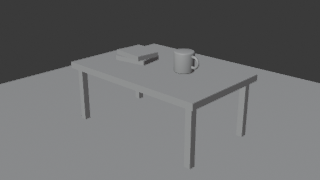

# blender-axi

An agent-ergonomic CLI for Blender that follows the [AXI principles](https://axi.md): compact TOON
output, content-first home view, structured errors with exit codes, next-step hints and short
per-command help. It runs Blender headless (`blender --background`) by default; an optional live mode
talks to a running Blender through the official MCP add-on's socket.

Licensed GPL-3.0-or-later (see `LICENSE`).

## Why: fewer tokens for AI agents working in Blender

blender-axi exists to cut the context an AI agent spends on Blender. It does this in three ways.

1. **No per-session tool schemas.** An MCP client loads every tool definition into context at the
   start of every session. blender-axi is a CLI. Its agent skill (`skills/blender-axi/SKILL.md`)
   loads only when a Blender task comes up, and `blender-axi --help` covers the rest.
2. **Compact output.** TOON tables instead of indented JSON, and the common fields by default
   (`--fields` and `--full` give the rest), with counts precomputed ("5 of 12 total").
3. **Fewer round trips.** Every result ends with the next useful command, errors say how to fix the
   call, and empty results say so outright (`0 objects matching type=CAMERA in desk.blend`).

The numbers below come from `benchmarks/token_bench.py`: both tools read the same scenes in one
running Blender 5.2, and every output is counted. The official tools return more fields than
blender-axi's defaults, so compare per task, not field for field. To reproduce:
`.venv/Scripts/python.exe benchmarks/token_bench.py` (artifacts in `benchmarks/results/`, details in
`benchmarks/results/results.md`).

<!-- bench:start -->
**Measured against the official `blender-mcp` server, same live Blender:**

*city: 502 objects, 21 collections*

| Task | Official MCP, tokens (claude-opus-5-5) | blender-axi, tokens (claude-opus-5-5) | Saving | Note |
|---|---:|---:|---:|---|
| Scene overview | 310 ([raw](benchmarks/results/city/scene__mcp.json)) | 341 ([raw](benchmarks/results/city/scene__axi.txt)) | -10.0% |  |
| List objects (default --limit 100) | 41,531 ([raw, truncated](benchmarks/results/city/objects__mcp.json)) | 2,100 ([raw](benchmarks/results/city/objects__axi.txt)) | 94.9% |  |
| List all 502 objects | 41,531 ([raw, truncated](benchmarks/results/city/objects__mcp.json)) | 9,494 ([raw](benchmarks/results/city/objects_all__axi.txt)) | 77.1% | MCP call shared with objects |
| Objects in District05 | 41,531 ([raw, truncated](benchmarks/results/city/objects__mcp.json)) | 540 ([raw](benchmarks/results/city/objects_collection__axi.txt)) | 98.7% | MCP has no collection filter: full list; MCP call shared with objects |
| Objects named *Tree* | 41,531 ([raw, truncated](benchmarks/results/city/objects__mcp.json)) | 1,860 ([raw](benchmarks/results/city/objects_tree__axi.txt)) | 95.5% | MCP has no name filter: full list; MCP call shared with objects |
| One object: D05_Bldg03 | 396 ([raw](benchmarks/results/city/object_bldg__mcp.json)) | 174 ([raw](benchmarks/results/city/object_bldg__axi.txt)) | 56.1% |  |

| Item | Official MCP, tokens (claude-opus-5-5) | blender-axi, tokens (claude-opus-5-5) | Saving |
|---|---:|---:|---:|
| Tool definitions vs. skill text | 7,843 (26 tools, [raw](benchmarks/results/fixed/tools_list__mcp.json)) | 1,255 ([raw](skills/blender-axi/SKILL.md)) | 84.0% |

*The tool-list figure is a lower bound: it is the compact JSON of the server's `tools/list` reply, and real clients serialise tool schemas more verbosely.*

 


Unit: tokens (claude-opus-5-5), measured 2026-10-25. Details: [results.md](benchmarks/results/results.md).
<!-- bench:end -->

## Install (development)

```bash
uv venv .venv --python 3.13
uv pip install --python .venv -e ".[dev]"
.venv/Scripts/blender-axi --help
```

Blender 5.2 LTS is verified. blender-axi finds it via `--blender <path>`, `BLENDER_AXI_BLENDER`,
`BLENDER_PATH`, `PATH`, or the default install location.

## Commands

| Command | What it does |
|---|---|
| `blender-axi` | Home view: Blender found, live status, `.blend` files here |
| `scene [<file>]` | Overview of a .blend file: engine, resolution, frames, camera, object/collection counts |
| `objects [<file>] [--type T] [--collection C] [--name-contains S] [--limit N] [--fields a,b]` | List objects (name, type, collection, visible); extra columns: location, dimensions, parent, verts, faces, materials, modifiers, data |
| `object <name> [<file>]` | One object's transform, dimensions, parent/children, materials, modifiers, custom props |
| `exec [<file>] --code <python> \| --script <path> --allow-exec` | Run Python inside Blender; `bpy` is predefined, assign a dict to `result` |

| `render [<file>] [--frame n \| --frames a..b] [--out path] [--engine WORKBENCH\|EEVEE\|CYCLES] [--resolution WxH] [--percent n] [--samples n] [--camera name] [--format PNG\|JPEG\|…] [--force]` | Render stills or a frame range (default `./<stem>_f####.png`) |
| `export [<file>] --out path [--format glb\|gltf\|fbx\|obj\|stl\|ply\|usd\|usdc\|usda\|abc] [--collection name \| --objects a,b] [--force]` | Export the scene, a collection or objects to a 3D file |

| `live` | Check a running Blender (MCP add-on server) and show the open file |

`<file>` is optional when the current directory has exactly one `.blend` (it is echoed as `file:`).
Outputs are never overwritten without `--force` (`WRITE_REFUSED`, exit 1). Renders time out after
600 s, other commands after 120 s; `--timeout` overrides both.

### Running code (`exec`)

`exec` runs arbitrary Python inside Blender, so it refuses to start without `--allow-exec` (exit 2, and the
error shows the same command with the flag added; Blender is not launched). The original `.blend` is never
written unless you pass `--in-place`. When the code changes the scene, the result is saved as a copy under
`.tmp/exec/` (or at `--out <path.blend>`; an existing file is refused without `--force`). Code that changes
nothing writes nothing (`modified: false`). With `--in-place`, Blender keeps the previous version as
`<file>.blend1` and the result reports it as `backup:`.

## Live mode

`--live` runs a command against a Blender that is already open (the file, unsaved edits and selection
included) instead of starting a headless one. It talks to the official **MCP** add-on (extension id `mcp`,
Blender Lab, Blender 5.1 or newer) over its local TCP socket, default `localhost:9876`.

- GUI: enable the **MCP** extension in Preferences > Add-ons. Auto Start is on by default; Host and Port
  live in the add-on preferences, which also have a start/stop button.
- Headless: `blender --background --online-mode --command blender_mcp --host 127.0.0.1 --port 9876 [file.blend]`
  (no `--factory-startup`: the extension lives in your user config; `--online-mode` is required).
- Check it with `blender-axi live`, then `blender-axi scene --live`, `blender-axi objects --live`,
  `blender-axi object Cube --live`. Other address: `--host <host> --port <n>`. Socket timeout 300 s.
- In live mode the file is whatever is open in Blender, so do not pass a `<file>` argument.
- Blender must run on the same machine: the code sent to it imports `blender_axi` from this install's
  `src` directory. The MCP add-on executes arbitrary code with no sandbox, so only run its server on a
  trusted machine and loopback.

The socket protocol (NUL-terminated JSON `execute` requests) is the one defined by the Blender Lab MCP
add-on, GPL-3.0-or-later, https://projects.blender.org/lab/blender_mcp (commit dbbf836);
`blender_axi/live.py` is adapted from its documented behaviour.

## Global flags

- `--help` — show help for the command (valid anywhere, skips validation)
- `--json` — emit JSON instead of TOON
- `--full` — do not truncate long text fields (default cut at 1500 chars)
- `--debug` — print tracebacks and Blender stderr to stderr
- `--keep-tmp` — keep per-run temp directories under `.tmp/`
- `--blender <path>` — Blender executable (or set `BLENDER_AXI_BLENDER`)
- `--timeout <seconds>` — override timeouts (default 120, render 600, live 300)
- `--live` — talk to a running Blender instead of starting one
- `--host <host>` / `--port <n>` — live-mode address (default localhost:9876)

Global flags may appear before or after the command; `--no-<flag>` works for the boolean ones.

## Where temp files go

blender-axi never writes to the system temp directory. Run directories, Blender's own
`TEMP`/`TMP`/`TMPDIR`, `exec` copies and test output all live under one root: `$BLENDER_AXI_TMP` if
set, else `<checkout>/.tmp` when running from a source checkout, else `%LOCALAPPDATA%\blender-axi\tmp`
(or `~/.cache/blender-axi/tmp`). Run directories are deleted after each command unless you pass
`--keep-tmp`. Blender is always started with `--factory-startup`.

## Skill

`skills/blender-axi/SKILL.md` is an installable agent skill (for example
`npx skills add <owner>/<repo> --skill blender-axi`). It loads on demand when an agent recognises a
Blender task and carries no per-session token cost. It is generated from the command registry and
the global flags, so it never drifts from the CLI:

    blender-axi skill gen            # write skills/blender-axi/SKILL.md
    blender-axi skill gen --check    # exit 1 if the committed skill is missing or stale

Run `skill gen` after adding or changing a command. Running `blender-axi` with no arguments prints
the live home view (Blender location, live-session reachability, `.blend` files in the current
directory). There is no SessionStart hook in v1; the skill is the discovery path.
