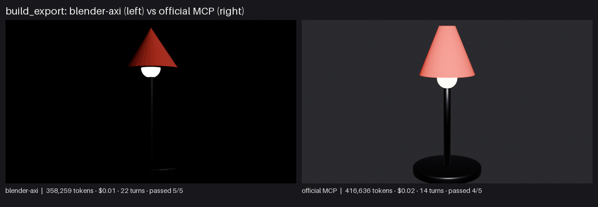
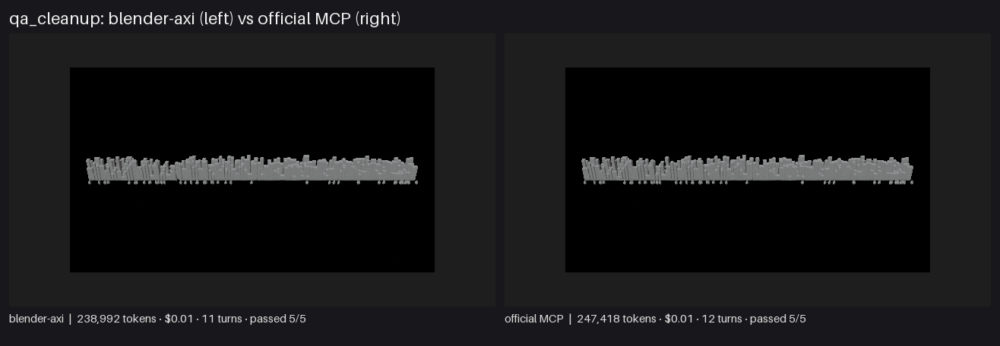
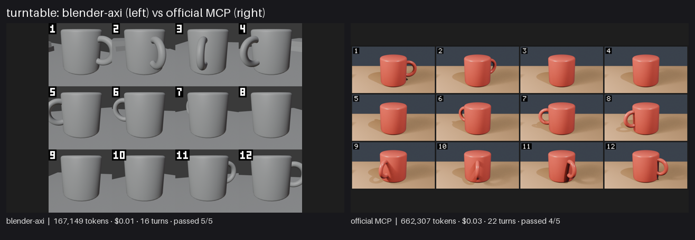

# blender-axi showcase results

Date 2026-11-04 · model claude-haiku-5-5 · effort medium · repeats per cell 5 · blender-axi 0.9.0 · Blender 5.2.0 · claude 2.1.317 · official MCP server 1.0.2 (dbbf836).

All costs are client-side list-price estimates from `claude -p`, not invoices. Cells show the median of the repeats, with min–max below it.

## Summary

| Project | Arm | Passed | Input tokens | Output tokens | Cost (est.) | Turns | Tool calls | Wall |
|---|---|---:|---:|---:|---:|---:|---:|---:|
| build_export | blender-axi | 5/5 | 347,721<br><sub>224,054–568,388</sub> | 10,538<br><sub>8,113–15,509</sub> | $0.01<br><sub>$0.01–$0.02</sub> | 22<br><sub>14–28</sub> | 21<br><sub>13–27</sub> | 77s<br><sub>51s–97s</sub> |
| build_export | official MCP | 4/5 | 396,099<br><sub>241,828–546,816</sub> | 20,537<br><sub>12,826–26,302</sub> | $0.02<br><sub>$0.01–$0.02</sub> | 14<br><sub>13–20</sub> | 13<br><sub>12–19</sub> | 96s<br><sub>62s–120s</sub> |
| qa_cleanup | blender-axi | 5/5 | 226,559<br><sub>197,658–360,269</sub> | 12,433<br><sub>11,601–18,756</sub> | $0.01<br><sub>$0.01–$0.02</sub> | 11<br><sub>11–14</sub> | 10<br><sub>10–13</sub> | 79s<br><sub>73s–112s</sub> |
| qa_cleanup | official MCP | 5/5 | 236,083<br><sub>195,872–343,309</sub> | 11,335<br><sub>10,723–15,500</sub> | $0.01 | 12<br><sub>11–15</sub> | 11<br><sub>10–14</sub> | 53s<br><sub>51s–70s</sub> |
| turntable | blender-axi | 5/5 | 159,999<br><sub>139,858–229,425</sub> | 7,150<br><sub>4,610–9,708</sub> | $0.01 | 16<br><sub>9–17</sub> | 13<br><sub>8–15</sub> | 59s<br><sub>39s–65s</sub> |
| turntable | official MCP | 4/5 | 626,037<br><sub>460,473–1,033,754</sub> | 36,270<br><sub>22,898–42,855</sub> | $0.03<br><sub>$0.02–$0.04</sub> | 22<br><sub>18–29</sub> | 21<br><sub>16–28</sub> | 171s<br><sub>122s–204s</sub> |

## build_export

Prompt (identical for both arms):

```text
Starting from the empty file `{WORK}`, build a simple desk lamp: a round base (dark metal material), a thin vertical stem, a cone head (matte red), a small emissive bulb inside the head; add a bevel to the base; add a camera framing the lamp and one light; set EEVEE, 640x360, 16 samples; render `{OUT}/lamp.png`; export only the lamp meshes (no camera or light) with modifiers applied to `{OUT}/lamp.glb`; save the scene as `{OUT}/lamp.blend`. Write every output under `{OUT}` (it already exists) and do not create anything outside it or `{WORK}`; write text files such as reports with the Write tool.
```



Replays: [blender-axi](build_export/replay_axi.gif) · [official MCP](build_export/replay_mcp.gif). Transcripts: [blender-axi](build_export/transcript_axi.md) · [official MCP](build_export/transcript_mcp.md).

Every repeat (failures are reported, never re-rolled):

| Arm | Repeat | Passed | Failed checks | Stop | Input | Output | Cost | Turns | Tool calls | Errors | Wall |
|---|---:|---:|---|---|---:|---:|---:|---:|---:|---:|---:|
| blender-axi | 1 | yes | - | end_turn | 224,054 | 8,113 | $0.01 | 14 | 13 | 2 | 51s |
| blender-axi | 2 | yes | - | end_turn | 466,144 | 12,784 | $0.01 | 28 | 27 | 8 | 83s |
| blender-axi | 3 | yes | - | end_turn | 568,388 | 15,509 | $0.02 | 22 | 21 | 4 | 97s |
| blender-axi | 4 | yes | - | end_turn | 299,075 | 10,538 | $0.01 | 23 | 22 | 3 | 77s |
| blender-axi | 5 | yes | - | end_turn | 347,721 | 9,501 | $0.01 | 19 | 18 | 5 | 66s |
| official MCP | 1 | yes | - | end_turn | 538,873 | 21,582 | $0.02 | 20 | 19 | 2 | 104s |
| official MCP | 2 | yes | - | end_turn | 396,099 | 26,302 | $0.02 | 14 | 13 | 1 | 120s |
| official MCP | 3 | NO | glb_clean, glb_magic, glb_meshes | end_turn | 262,171 | 12,826 | $0.01 | 13 | 12 | 1 | 62s |
| official MCP | 4 | yes | - | end_turn | 241,828 | 13,621 | $0.01 | 13 | 12 | 1 | 64s |
| official MCP | 5 | yes | - | end_turn | 546,816 | 20,537 | $0.02 | 18 | 17 | 2 | 96s |

## qa_cleanup

Prompt (identical for both arms):

```text
Audit `{WORK}` for asset problems, then fix exactly these and save the result as `{OUT}/clean.blend`: delete every object whose name starts with `Debug_`; make every object in collection `District05` visible and renderable; remove empty collections; remove unused materials and the image with a missing file; change nothing else. Write `{OUT}/report.md` with a before/after summary (counts of objects, collections, materials, images, and the problems you found). Write every output under `{OUT}` (it already exists) and do not create anything outside it or `{WORK}`; write text files such as reports with the Write tool.
```



Replays: [blender-axi](qa_cleanup/replay_axi.gif) · [official MCP](qa_cleanup/replay_mcp.gif). Transcripts: [blender-axi](qa_cleanup/transcript_axi.md) · [official MCP](qa_cleanup/transcript_mcp.md).

Every repeat (failures are reported, never re-rolled):

| Arm | Repeat | Passed | Failed checks | Stop | Input | Output | Cost | Turns | Tool calls | Errors | Wall |
|---|---:|---:|---|---|---:|---:|---:|---:|---:|---:|---:|
| blender-axi | 1 | yes | - | end_turn | 360,269 | 18,756 | $0.02 | 14 | 13 | 1 | 112s |
| blender-axi | 2 | yes | - | end_turn | 309,401 | 12,433 | $0.01 | 11 | 10 | 1 | 79s |
| blender-axi | 3 | yes | - | end_turn | 226,559 | 11,601 | $0.01 | 11 | 10 | 1 | 73s |
| blender-axi | 4 | yes | - | end_turn | 217,912 | 11,855 | $0.01 | 11 | 10 | 1 | 73s |
| blender-axi | 5 | yes | - | end_turn | 197,658 | 14,339 | $0.01 | 11 | 10 | 1 | 79s |
| official MCP | 1 | yes | - | end_turn | 282,521 | 13,297 | $0.01 | 13 | 12 | 1 | 64s |
| official MCP | 2 | yes | - | end_turn | 195,872 | 10,723 | $0.01 | 11 | 10 | 1 | 52s |
| official MCP | 3 | yes | - | end_turn | 215,533 | 10,969 | $0.01 | 11 | 10 | 1 | 51s |
| official MCP | 4 | yes | - | end_turn | 236,083 | 11,335 | $0.01 | 12 | 11 | 1 | 53s |
| official MCP | 5 | yes | - | end_turn | 343,309 | 15,500 | $0.01 | 15 | 14 | 1 | 70s |

## turntable

Prompt (identical for both arms):

```text
The file `{WORK}` is a small desk scene (already lit, with a camera). Make product shots of the object named `Mug`: (1) a 12-frame turntable around the Mug, ignoring the floor, as ONE numbered contact sheet `{OUT}/sheet.png` at least 1280 px wide; (2) the same 12 frames as `{OUT}/turntable.mp4` at 12 fps; (3) a hero still `{OUT}/hero.png` of the Mug from a three-quarter angle, at least 640 px wide. Use WORKBENCH or EEVEE and keep render time low. Leave `{WORK}` unchanged on disk. Write every output under `{OUT}` (it already exists) and do not create anything outside it or `{WORK}`; write text files such as reports with the Write tool.
```



Replays: [blender-axi](turntable/replay_axi.gif) · [official MCP](turntable/replay_mcp.gif). Transcripts: [blender-axi](turntable/transcript_axi.md) · [official MCP](turntable/transcript_mcp.md).

Every repeat (failures are reported, never re-rolled):

| Arm | Repeat | Passed | Failed checks | Stop | Input | Output | Cost | Turns | Tool calls | Errors | Wall |
|---|---:|---:|---|---|---:|---:|---:|---:|---:|---:|---:|
| blender-axi | 1 | yes | - | end_turn | 139,858 | 4,610 | $0.01 | 9 | 8 | 1 | 39s |
| blender-axi | 2 | yes | - | end_turn | 156,789 | 9,708 | $0.01 | 14 | 12 | 2 | 65s |
| blender-axi | 3 | yes | - | end_turn | 187,426 | 5,962 | $0.01 | 16 | 13 | 2 | 54s |
| blender-axi | 4 | yes | - | end_turn | 229,425 | 7,505 | $0.01 | 16 | 14 | 4 | 59s |
| blender-axi | 5 | yes | - | end_turn | 159,999 | 7,150 | $0.01 | 17 | 15 | 4 | 63s |
| official MCP | 1 | yes | - | end_turn | 581,515 | 22,898 | $0.02 | 23 | 22 | 1 | 122s |
| official MCP | 2 | NO | mp4_frames | end_turn | 1,033,754 | 42,855 | $0.04 | 29 | 28 | 1 | 204s |
| official MCP | 3 | yes | - | end_turn | 626,037 | 36,270 | $0.03 | 22 | 21 | 1 | 171s |
| official MCP | 4 | yes | - | end_turn | 460,473 | 26,126 | $0.02 | 18 | 16 | 1 | 128s |
| official MCP | 5 | yes | - | end_turn | 693,686 | 40,171 | $0.03 | 22 | 21 | 2 | 190s |

## Fixed cost per session

First-turn cache creation: the Claude Code system prompt plus the instrument's own text (26 MCP tool schemas for the MCP arm, the appended SKILL.md for blender-axi). Measured per run, median shown.

| Project | blender-axi first-turn cache creation (tokens) | official MCP first-turn cache creation (tokens) |
|---|---:|---:|
| build_export | 387 | 1,828 |
| qa_cleanup | 391 | 1,832 |
| turntable | 1,265 | 1,828 |

## Where the official MCP is equal or better

- (a) one-shot builds — a competent agent writes one `execute_blender_code` script and finishes #3 in 2–4 tool calls, so tokens may tie or MCP may win on wall time (blender-axi starts Blender once per command);
- (b) scene overview (`scene` saved only 2.9–11.3% in the 0.6.0 bench);
- (c) fixes that have no typed blender-axi command (purging orphan data, deleting collections, applying transforms) force blender-axi's agent to `exec` too, i.e. parity;
- (d) `search_api_docs`/`get_python_api_docs` give the MCP agent API help blender-axi lacks;
- (e) anything GUI (screenshots, viewport jumps) is MCP-only and out of this headless showcase;
- (f) the MCP arm keeps one Blender process alive, blender-axi pays a Blender start per command unless it batches with `apply`.

## Method and fairness

- Same prompt, model, effort, starting .blend, runner (`claude -p` stream-json), working directory shape and tool budget (`Read`, `Write` plus exactly one instrument) for both arms.
- blender-axi arm: `Bash` restricted to `blender-axi *`, SKILL.md appended to the system prompt. MCP arm: the official server against a headless add-on server on the same start file, no skill text.
- Success is decided by a plain `bpy` checker, not by either tool and not by the agent's own claim.
- N repeats per cell, sequential; Blender processes started are counted from the transcript (blender-axi) or fixed at 1 (MCP).

### Honesty rules

- Every repeat is listed; failed or cut runs stay in the table and count against the success column.
- Wall time is structurally biased: the MCP arm keeps one Blender alive, blender-axi pays a start per command unless it batches with `apply`. It is reported, not claimed.
- The list above states where the official MCP is equal or better.

## Reproduce

```bash
.venv/Scripts/python.exe benchmarks/showcase/run_ab.py --project all --arm both --repeats 3 --model claude-opus-5-5
```

See [benchmarks/showcase/README.md](../README.md) for prerequisites.
