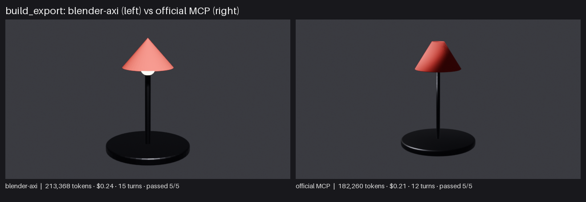
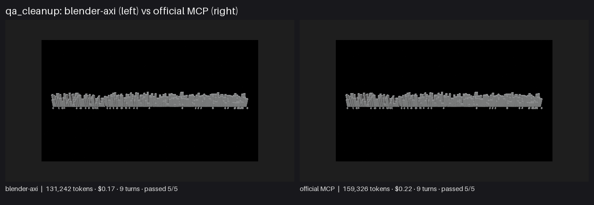
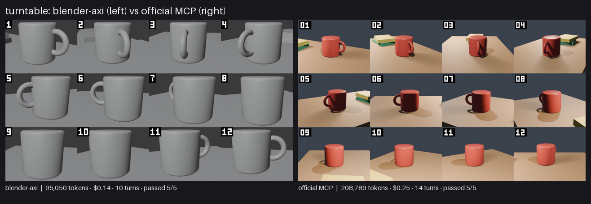

# blender-axi showcase results

Date 2026-11-04 · model claude-opus-5-5 · effort medium · repeats per cell 5 · blender-axi 0.9.0 · Blender 5.2.0 · claude 2.1.317 · official MCP server 1.0.2 (dbbf836).

All costs are client-side list-price estimates from `claude -p`, not invoices. Cells show the median of the repeats, with min–max below it.

## Summary

| Project | Arm | Passed | Input tokens | Output tokens | Cost (est.) | Turns | Tool calls | Wall |
|---|---|---:|---:|---:|---:|---:|---:|---:|
| build_export | blender-axi | 5/5 | 207,424<br><sub>166,488–310,680</sub> | 5,944<br><sub>4,503–8,646</sub> | $0.24<br><sub>$0.17–$0.33</sub> | 15<br><sub>14–19</sub> | 14<br><sub>13–18</sub> | 80s<br><sub>67s–125s</sub> |
| build_export | official MCP | 5/5 | 176,271<br><sub>139,164–188,491</sub> | 5,989<br><sub>5,567–6,710</sub> | $0.21<br><sub>$0.19–$0.22</sub> | 12<br><sub>9–12</sub> | 10<br><sub>8–11</sub> | 68s<br><sub>55s–77s</sub> |
| qa_cleanup | blender-axi | 5/5 | 126,418<br><sub>68,963–401,160</sub> | 4,824<br><sub>3,567–8,412</sub> | $0.17<br><sub>$0.12–$0.38</sub> | 9<br><sub>6–15</sub> | 8<br><sub>5–14</sub> | 78s<br><sub>55s–113s</sub> |
| qa_cleanup | official MCP | 5/5 | 152,734<br><sub>146,019–184,482</sub> | 6,592<br><sub>5,586–6,923</sub> | $0.22<br><sub>$0.20–$0.23</sub> | 9<br><sub>9–11</sub> | 8<br><sub>8–10</sub> | 66s<br><sub>60s–76s</sub> |
| turntable | blender-axi | 5/5 | 92,623<br><sub>63,365–141,337</sub> | 2,427<br><sub>1,793–3,112</sub> | $0.14<br><sub>$0.10–$0.16</sub> | 10<br><sub>6–12</sub> | 8<br><sub>5–10</sub> | 53s<br><sub>34s–56s</sub> |
| turntable | official MCP | 5/5 | 202,510<br><sub>169,856–224,775</sub> | 6,279<br><sub>6,178–7,028</sub> | $0.25<br><sub>$0.24–$0.28</sub> | 14<br><sub>10–15</sub> | 13<br><sub>9–14</sub> | 77s<br><sub>72s–85s</sub> |

## build_export

Prompt (identical for both arms):

```text
Starting from the empty file `{WORK}`, build a simple desk lamp: a round base (dark metal material), a thin vertical stem, a cone head (matte red), a small emissive bulb inside the head; add a bevel to the base; add a camera framing the lamp and one light; set EEVEE, 640x360, 16 samples; render `{OUT}/lamp.png`; export only the lamp meshes (no camera or light) with modifiers applied to `{OUT}/lamp.glb`; save the scene as `{OUT}/lamp.blend`. Write every output under `{OUT}` (it already exists) and do not create anything outside it or `{WORK}`; write text files such as reports with the Write tool.
```



Replays: [blender-axi](build_export/replay_axi.gif) · [official MCP](build_export/replay_mcp.gif). Transcripts: [blender-axi](build_export/transcript_axi.md) · [official MCP](build_export/transcript_mcp.md).

Every repeat (failures are reported, never re-rolled):

| Arm | Repeat | Passed | Failed checks | Stop | Input | Output | Cost | Turns | Tool calls | Errors | Wall |
|---|---:|---:|---|---|---:|---:|---:|---:|---:|---:|---:|
| blender-axi | 1 | yes | - | end_turn | 310,680 | 8,646 | $0.33 | 19 | 18 | 3 | 125s |
| blender-axi | 2 | yes | - | end_turn | 170,431 | 4,503 | $0.17 | 15 | 14 | 3 | 74s |
| blender-axi | 3 | yes | - | end_turn | 207,424 | 5,944 | $0.24 | 16 | 15 | 4 | 80s |
| blender-axi | 4 | yes | - | end_turn | 215,030 | 6,908 | $0.26 | 15 | 14 | 3 | 92s |
| blender-axi | 5 | yes | - | end_turn | 166,488 | 5,035 | $0.19 | 14 | 13 | 3 | 67s |
| official MCP | 1 | yes | - | end_turn | 141,045 | 5,567 | $0.19 | 10 | 9 | 0 | 55s |
| official MCP | 2 | yes | - | end_turn | 176,271 | 6,227 | $0.21 | 12 | 11 | 1 | 68s |
| official MCP | 3 | yes | - | end_turn | 139,164 | 5,829 | $0.19 | 9 | 8 | 0 | 57s |
| official MCP | 4 | yes | - | end_turn | 188,491 | 6,710 | $0.22 | 12 | 10 | 0 | 77s |
| official MCP | 5 | yes | - | end_turn | 187,033 | 5,989 | $0.21 | 12 | 11 | 0 | 73s |

## qa_cleanup

Prompt (identical for both arms):

```text
Audit `{WORK}` for asset problems, then fix exactly these and save the result as `{OUT}/clean.blend`: delete every object whose name starts with `Debug_`; make every object in collection `District05` visible and renderable; remove empty collections; remove unused materials and the image with a missing file; change nothing else. Write `{OUT}/report.md` with a before/after summary (counts of objects, collections, materials, images, and the problems you found). Write every output under `{OUT}` (it already exists) and do not create anything outside it or `{WORK}`; write text files such as reports with the Write tool.
```



Replays: [blender-axi](qa_cleanup/replay_axi.gif) · [official MCP](qa_cleanup/replay_mcp.gif). Transcripts: [blender-axi](qa_cleanup/transcript_axi.md) · [official MCP](qa_cleanup/transcript_mcp.md).

Every repeat (failures are reported, never re-rolled):

| Arm | Repeat | Passed | Failed checks | Stop | Input | Output | Cost | Turns | Tool calls | Errors | Wall |
|---|---:|---:|---|---|---:|---:|---:|---:|---:|---:|---:|
| blender-axi | 1 | yes | - | end_turn | 68,963 | 3,567 | $0.12 | 6 | 5 | 0 | 55s |
| blender-axi | 2 | yes | - | end_turn | 401,160 | 8,412 | $0.38 | 15 | 14 | 3 | 113s |
| blender-axi | 3 | yes | - | end_turn | 126,418 | 4,754 | $0.17 | 9 | 8 | 1 | 78s |
| blender-axi | 4 | yes | - | end_turn | 265,521 | 7,739 | $0.32 | 14 | 13 | 5 | 91s |
| blender-axi | 5 | yes | - | end_turn | 116,198 | 4,824 | $0.17 | 9 | 8 | 1 | 66s |
| official MCP | 1 | yes | - | end_turn | 184,482 | 6,736 | $0.23 | 11 | 10 | 1 | 76s |
| official MCP | 2 | yes | - | end_turn | 149,632 | 6,592 | $0.22 | 9 | 8 | 1 | 66s |
| official MCP | 3 | yes | - | end_turn | 146,019 | 5,872 | $0.20 | 9 | 8 | 1 | 60s |
| official MCP | 4 | yes | - | end_turn | 167,134 | 6,923 | $0.23 | 10 | 9 | 1 | 66s |
| official MCP | 5 | yes | - | end_turn | 152,734 | 5,586 | $0.20 | 9 | 8 | 1 | 63s |

## turntable

Prompt (identical for both arms):

```text
The file `{WORK}` is a small desk scene (already lit, with a camera). Make product shots of the object named `Mug`: (1) a 12-frame turntable around the Mug, ignoring the floor, as ONE numbered contact sheet `{OUT}/sheet.png` at least 1280 px wide; (2) the same 12 frames as `{OUT}/turntable.mp4` at 12 fps; (3) a hero still `{OUT}/hero.png` of the Mug from a three-quarter angle, at least 640 px wide. Use WORKBENCH or EEVEE and keep render time low. Leave `{WORK}` unchanged on disk. Write every output under `{OUT}` (it already exists) and do not create anything outside it or `{WORK}`; write text files such as reports with the Write tool.
```



Replays: [blender-axi](turntable/replay_axi.gif) · [official MCP](turntable/replay_mcp.gif). Transcripts: [blender-axi](turntable/transcript_axi.md) · [official MCP](turntable/transcript_mcp.md).

Every repeat (failures are reported, never re-rolled):

| Arm | Repeat | Passed | Failed checks | Stop | Input | Output | Cost | Turns | Tool calls | Errors | Wall |
|---|---:|---:|---|---|---:|---:|---:|---:|---:|---:|---:|
| blender-axi | 1 | yes | - | end_turn | 92,623 | 2,427 | $0.16 | 10 | 8 | 1 | 53s |
| blender-axi | 2 | yes | - | end_turn | 63,365 | 1,793 | $0.10 | 6 | 5 | 0 | 34s |
| blender-axi | 3 | yes | - | end_turn | 123,162 | 3,005 | $0.14 | 11 | 10 | 3 | 56s |
| blender-axi | 4 | yes | - | end_turn | 141,337 | 3,112 | $0.15 | 12 | 10 | 2 | 55s |
| blender-axi | 5 | yes | - | end_turn | 78,598 | 1,991 | $0.10 | 7 | 6 | 0 | 38s |
| official MCP | 1 | yes | - | end_turn | 202,510 | 6,279 | $0.28 | 14 | 13 | 1 | 72s |
| official MCP | 2 | yes | - | end_turn | 182,081 | 6,446 | $0.25 | 13 | 10 | 1 | 76s |
| official MCP | 3 | yes | - | end_turn | 224,775 | 6,244 | $0.24 | 14 | 13 | 1 | 85s |
| official MCP | 4 | yes | - | end_turn | 169,856 | 7,028 | $0.26 | 10 | 9 | 1 | 77s |
| official MCP | 5 | yes | - | end_turn | 224,068 | 6,178 | $0.24 | 15 | 14 | 1 | 77s |

## Fixed cost per session

First-turn cache creation: the Claude Code system prompt plus the instrument's own text (26 MCP tool schemas for the MCP arm, the appended SKILL.md for blender-axi). Measured per run, median shown.

| Project | blender-axi first-turn cache creation (tokens) | official MCP first-turn cache creation (tokens) |
|---|---:|---:|
| build_export | 361 | 1,802 |
| qa_cleanup | 365 | 1,806 |
| turntable | 361 | 1,802 |

## Where the official MCP is equal or better

- (a) one-shot builds — a competent agent writes one `execute_blender_code` script and finishes #3 in 2–4 tool calls, so tokens may tie or MCP may win on wall time (blender-axi starts Blender once per command);
- (b) scene overview (`scene` saved only 2.9–11.3% in the 0.6.0 bench);
- (c) fixes that have no typed blender-axi command (purging orphan data, deleting collections, applying transforms) force blender-axi's agent to `exec` too, i.e. parity;
- (d) `search_api_docs`/`get_python_api_docs` give the MCP agent API help blender-axi lacks;
- (e) anything GUI (screenshots, viewport jumps) is MCP-only and out of this headless showcase;
- (f) the MCP arm keeps one Blender process alive, blender-axi pays a Blender start per command unless it batches with `apply`.

## Method and fairness

- Same prompt, model, effort, starting .blend, runner (`claude -p` stream-json), working directory shape and tool budget (`Read`, `Write` plus exactly one instrument) for both arms.
- blender-axi arm: `Bash` restricted to `blender-axi *`, SKILL.md appended to the system prompt. MCP arm: the official server against a headless add-on server on the same start file, no skill text.
- Success is decided by a plain `bpy` checker, not by either tool and not by the agent's own claim.
- N repeats per cell, sequential; Blender processes started are counted from the transcript (blender-axi) or fixed at 1 (MCP).

### Honesty rules

- Every repeat is listed; failed or cut runs stay in the table and count against the success column.
- Wall time is structurally biased: the MCP arm keeps one Blender alive, blender-axi pays a start per command unless it batches with `apply`. It is reported, not claimed.
- The list above states where the official MCP is equal or better.

## Reproduce

```bash
.venv/Scripts/python.exe benchmarks/showcase/run_ab.py --project all --arm both --repeats 3 --model claude-opus-5-5
```

See [benchmarks/showcase/README.md](../README.md) for prerequisites.
