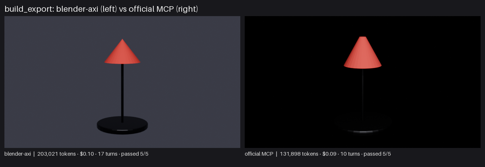
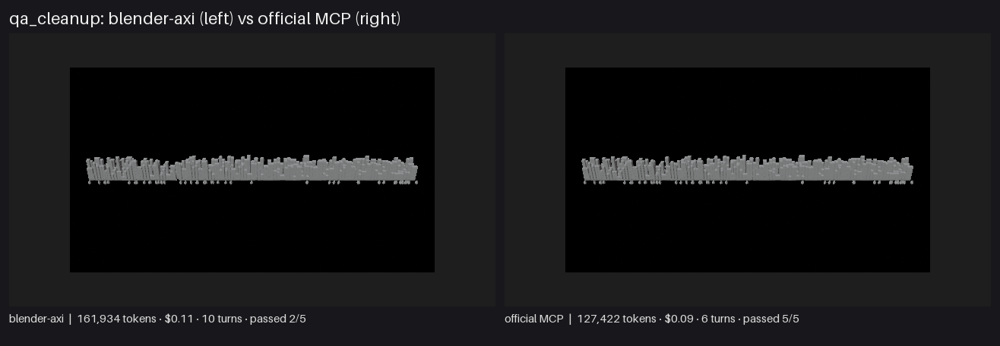
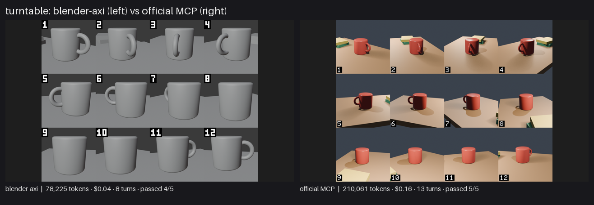

# blender-axi showcase results

Date 2026-11-04 · model claude-sonnet-5-5 · effort medium · repeats per cell 5 · blender-axi 0.9.0 · Blender 5.2.0 · claude 2.1.317 · official MCP server 1.0.2 (dbbf836).

All costs are client-side list-price estimates from `claude -p`, not invoices. Cells show the median of the repeats, with min–max below it.

## Summary

| Project | Arm | Passed | Input tokens | Output tokens | Cost (est.) | Turns | Tool calls | Wall |
|---|---|---:|---:|---:|---:|---:|---:|---:|
| build_export | blender-axi | 5/5 | 198,735<br><sub>177,927–247,784</sub> | 4,286<br><sub>4,181–5,209</sub> | $0.10<br><sub>$0.09–$0.11</sub> | 17<br><sub>15–21</sub> | 16<br><sub>14–20</sub> | 62s<br><sub>52s–70s</sub> |
| build_export | official MCP | 5/5 | 126,636<br><sub>108,640–131,945</sub> | 5,262<br><sub>4,808–5,331</sub> | $0.09<br><sub>$0.08–$0.09</sub> | 10<br><sub>8–11</sub> | 9<br><sub>7–10</sub> | 39s<br><sub>35s–42s</sub> |
| qa_cleanup | blender-axi | 2/5 | 155,744<br><sub>104,758–407,117</sub> | 6,190<br><sub>3,688–7,452</sub> | $0.11<br><sub>$0.07–$0.17</sub> | 10<br><sub>7–21</sub> | 9<br><sub>6–20</sub> | 63s<br><sub>43s–72s</sub> |
| qa_cleanup | official MCP | 5/5 | 124,025<br><sub>110,311–150,690</sub> | 3,397<br><sub>2,870–3,631</sub> | $0.09<br><sub>$0.08–$0.12</sub> | 6<br><sub>5–7</sub> | 5<br><sub>4–6</sub> | 28s<br><sub>25s–32s</sub> |
| turntable | blender-axi | 4/5 | 76,388<br><sub>51,786–241,824</sub> | 1,837<br><sub>968–3,599</sub> | $0.04<br><sub>$0.02–$0.09</sub> | 8<br><sub>5–19</sub> | 7<br><sub>4–18</sub> | 27s<br><sub>21s–58s</sub> |
| turntable | official MCP | 5/5 | 200,874<br><sub>132,193–235,940</sub> | 9,187<br><sub>6,351–9,653</sub> | $0.16<br><sub>$0.11–$0.17</sub> | 13<br><sub>11–18</sub> | 12<br><sub>10–15</sub> | 73s<br><sub>56s–90s</sub> |

## build_export

Prompt (identical for both arms):

```text
Starting from the empty file `{WORK}`, build a simple desk lamp: a round base (dark metal material), a thin vertical stem, a cone head (matte red), a small emissive bulb inside the head; add a bevel to the base; add a camera framing the lamp and one light; set EEVEE, 640x360, 16 samples; render `{OUT}/lamp.png`; export only the lamp meshes (no camera or light) with modifiers applied to `{OUT}/lamp.glb`; save the scene as `{OUT}/lamp.blend`. Write every output under `{OUT}` (it already exists) and do not create anything outside it or `{WORK}`; write text files such as reports with the Write tool.
```



Replays: [blender-axi](build_export/replay_axi.gif) · [official MCP](build_export/replay_mcp.gif). Transcripts: [blender-axi](build_export/transcript_axi.md) · [official MCP](build_export/transcript_mcp.md).

Every repeat (failures are reported, never re-rolled):

| Arm | Repeat | Passed | Failed checks | Stop | Input | Output | Cost | Turns | Tool calls | Errors | Wall |
|---|---:|---:|---|---|---:|---:|---:|---:|---:|---:|---:|
| blender-axi | 1 | yes | - | end_turn | 247,784 | 4,286 | $0.11 | 21 | 20 | 5 | 70s |
| blender-axi | 2 | yes | - | end_turn | 219,611 | 5,209 | $0.11 | 18 | 17 | 3 | 58s |
| blender-axi | 3 | yes | - | end_turn | 193,982 | 4,181 | $0.09 | 16 | 15 | 5 | 69s |
| blender-axi | 4 | yes | - | end_turn | 198,735 | 4,716 | $0.10 | 17 | 16 | 3 | 62s |
| blender-axi | 5 | yes | - | end_turn | 177,927 | 4,259 | $0.09 | 15 | 14 | 3 | 52s |
| official MCP | 1 | yes | - | end_turn | 111,751 | 5,262 | $0.09 | 9 | 8 | 0 | 42s |
| official MCP | 2 | yes | - | end_turn | 131,945 | 5,331 | $0.09 | 11 | 10 | 0 | 42s |
| official MCP | 3 | yes | - | end_turn | 130,075 | 4,908 | $0.09 | 10 | 9 | 0 | 35s |
| official MCP | 4 | yes | - | end_turn | 126,636 | 5,278 | $0.09 | 10 | 9 | 0 | 39s |
| official MCP | 5 | yes | - | end_turn | 108,640 | 4,808 | $0.08 | 8 | 7 | 0 | 36s |

## qa_cleanup

Prompt (identical for both arms):

```text
Audit `{WORK}` for asset problems, then fix exactly these and save the result as `{OUT}/clean.blend`: delete every object whose name starts with `Debug_`; make every object in collection `District05` visible and renderable; remove empty collections; remove unused materials and the image with a missing file; change nothing else. Write `{OUT}/report.md` with a before/after summary (counts of objects, collections, materials, images, and the problems you found). Write every output under `{OUT}` (it already exists) and do not create anything outside it or `{WORK}`; write text files such as reports with the Write tool.
```



Replays: [blender-axi](qa_cleanup/replay_axi.gif) · [official MCP](qa_cleanup/replay_mcp.gif). Transcripts: [blender-axi](qa_cleanup/transcript_axi.md) · [official MCP](qa_cleanup/transcript_mcp.md).

Every repeat (failures are reported, never re-rolled):

| Arm | Repeat | Passed | Failed checks | Stop | Input | Output | Cost | Turns | Tool calls | Errors | Wall |
|---|---:|---:|---|---|---:|---:|---:|---:|---:|---:|---:|
| blender-axi | 1 | yes | - | end_turn | 335,591 | 7,254 | $0.17 | 13 | 12 | 3 | 72s |
| blender-axi | 2 | NO | no_unused_materials | end_turn | 155,744 | 4,164 | $0.10 | 7 | 6 | 0 | 48s |
| blender-axi | 3 | NO | no_unused_materials | end_turn | 138,014 | 7,452 | $0.11 | 10 | 9 | 3 | 63s |
| blender-axi | 4 | NO | no_unused_materials | end_turn | 104,758 | 3,688 | $0.07 | 8 | 7 | 0 | 43s |
| blender-axi | 5 | yes | - | end_turn | 407,117 | 6,190 | $0.16 | 21 | 20 | 4 | 65s |
| official MCP | 1 | yes | - | end_turn | 116,034 | 2,870 | $0.09 | 5 | 4 | 0 | 25s |
| official MCP | 2 | yes | - | end_turn | 150,690 | 3,284 | $0.12 | 6 | 5 | 1 | 28s |
| official MCP | 3 | yes | - | end_turn | 131,250 | 3,397 | $0.11 | 5 | 4 | 1 | 27s |
| official MCP | 4 | yes | - | end_turn | 110,311 | 3,509 | $0.08 | 6 | 5 | 1 | 29s |
| official MCP | 5 | yes | - | end_turn | 124,025 | 3,631 | $0.08 | 7 | 6 | 1 | 32s |

## turntable

Prompt (identical for both arms):

```text
The file `{WORK}` is a small desk scene (already lit, with a camera). Make product shots of the object named `Mug`: (1) a 12-frame turntable around the Mug, ignoring the floor, as ONE numbered contact sheet `{OUT}/sheet.png` at least 1280 px wide; (2) the same 12 frames as `{OUT}/turntable.mp4` at 12 fps; (3) a hero still `{OUT}/hero.png` of the Mug from a three-quarter angle, at least 640 px wide. Use WORKBENCH or EEVEE and keep render time low. Leave `{WORK}` unchanged on disk. Write every output under `{OUT}` (it already exists) and do not create anything outside it or `{WORK}`; write text files such as reports with the Write tool.
```



Replays: [blender-axi](turntable/replay_axi.gif) · [official MCP](turntable/replay_mcp.gif). Transcripts: [blender-axi](turntable/transcript_axi.md) · [official MCP](turntable/transcript_mcp.md).

Every repeat (failures are reported, never re-rolled):

| Arm | Repeat | Passed | Failed checks | Stop | Input | Output | Cost | Turns | Tool calls | Errors | Wall |
|---|---:|---:|---|---|---:|---:|---:|---:|---:|---:|---:|
| blender-axi | 1 | yes | - | end_turn | 51,786 | 968 | $0.04 | 5 | 4 | 1 | 21s |
| blender-axi | 2 | yes | - | end_turn | 241,824 | 3,599 | $0.09 | 19 | 18 | 7 | 58s |
| blender-axi | 3 | yes | - | end_turn | 52,065 | 1,011 | $0.02 | 5 | 4 | 1 | 23s |
| blender-axi | 4 | NO | hero | end_turn | 76,388 | 1,837 | $0.04 | 8 | 7 | 4 | 27s |
| blender-axi | 5 | yes | - | end_turn | 104,487 | 2,279 | $0.05 | 9 | 7 | 2 | 32s |
| official MCP | 1 | yes | - | end_turn | 141,984 | 8,714 | $0.17 | 11 | 10 | 1 | 71s |
| official MCP | 2 | yes | - | end_turn | 235,940 | 9,536 | $0.16 | 18 | 15 | 1 | 90s |
| official MCP | 3 | yes | - | end_turn | 200,874 | 9,653 | $0.16 | 16 | 14 | 1 | 79s |
| official MCP | 4 | yes | - | end_turn | 132,193 | 6,351 | $0.11 | 11 | 10 | 1 | 56s |
| official MCP | 5 | yes | - | end_turn | 208,104 | 9,187 | $0.15 | 13 | 12 | 1 | 73s |

## Fixed cost per session

First-turn cache creation: the Claude Code system prompt plus the instrument's own text (26 MCP tool schemas for the MCP arm, the appended SKILL.md for blender-axi). Measured per run, median shown.

| Project | blender-axi first-turn cache creation (tokens) | official MCP first-turn cache creation (tokens) |
|---|---:|---:|
| build_export | 367 | 1,808 |
| qa_cleanup | 371 | 1,812 |
| turntable | 367 | 1,808 |

## Where the official MCP is equal or better

- (a) one-shot builds — a competent agent writes one `execute_blender_code` script and finishes #3 in 2–4 tool calls, so tokens may tie or MCP may win on wall time (blender-axi starts Blender once per command);
- (b) scene overview (`scene` saved only 2.9–11.3% in the 0.6.0 bench);
- (c) fixes that have no typed blender-axi command (purging orphan data, deleting collections, applying transforms) force blender-axi's agent to `exec` too, i.e. parity;
- (d) `search_api_docs`/`get_python_api_docs` give the MCP agent API help blender-axi lacks;
- (e) anything GUI (screenshots, viewport jumps) is MCP-only and out of this headless showcase;
- (f) the MCP arm keeps one Blender process alive, blender-axi pays a Blender start per command unless it batches with `apply`.

## Method and fairness

- Same prompt, model, effort, starting .blend, runner (`claude -p` stream-json), working directory shape and tool budget (`Read`, `Write` plus exactly one instrument) for both arms.
- blender-axi arm: `Bash` restricted to `blender-axi *`, SKILL.md appended to the system prompt. MCP arm: the official server against a headless add-on server on the same start file, no skill text.
- Success is decided by a plain `bpy` checker, not by either tool and not by the agent's own claim.
- N repeats per cell, sequential; Blender processes started are counted from the transcript (blender-axi) or fixed at 1 (MCP).

### Honesty rules

- Every repeat is listed; failed or cut runs stay in the table and count against the success column.
- Wall time is structurally biased: the MCP arm keeps one Blender alive, blender-axi pays a start per command unless it batches with `apply`. It is reported, not claimed.
- The list above states where the official MCP is equal or better.

## Reproduce

```bash
.venv/Scripts/python.exe benchmarks/showcase/run_ab.py --project all --arm both --repeats 3 --model claude-opus-5-5
```

See [benchmarks/showcase/README.md](../README.md) for prerequisites.
